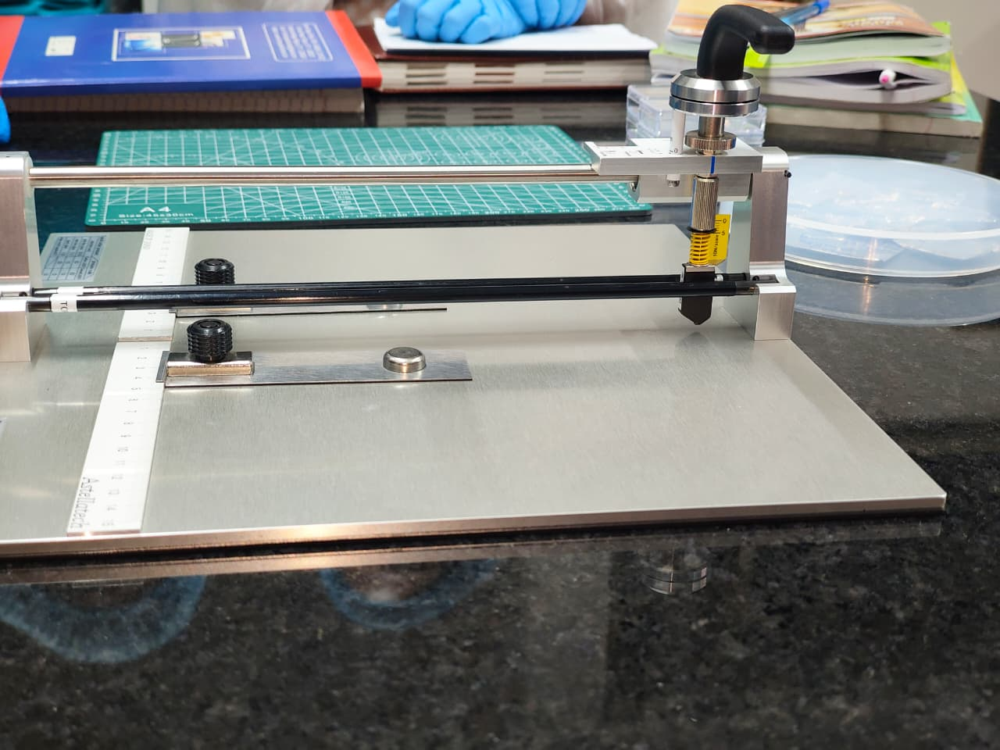
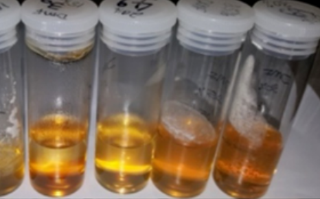

# Polymer Thin-Film Fabrication and Electrical Characterization

## Project Overview

This project involves hands-on laboratory work related to polymer thin-film fabrication, glass substrate preparation and electrical characterization.

The experimental work includes processing different polymer materials such as PVA, PVDF and PMMA, preparing glass substrates, studying fabrication parameters and investigating the electrical properties of fabricated samples.

## 1. Glass Substrate Preparation

Glass substrates were prepared using a precision glass cutter (Utile FU-200). The cutting equipment provides controlled positioning and cutting of glass samples for subsequent fabrication processes.

  

<b>Figure 1:</b> Precision glass cutting equipment used for substrate preparation.

## 2. Polymer Materials and Sample Preparation

Different polymer materials were used for experimental work:

- PVA – Polyvinyl Alcohol
- PVDF – Polyvinylidene Fluoride
- PMMA – Polymethyl Methacrylate

The samples were prepared and organized separately for fabrication and characterization.

  

<b>Figure 2:</b> Polymer samples prepared for experimental processing.

## 3. Thin-Film Processing

The fabrication work involved studying spin-coating parameters, including rotational speed and processing time, followed by thermal annealing.

The recorded experimental conditions included:

- Spin-coating speed
- Spin-coating duration
- Thermal annealing temperature
- Annealing duration

Different processing conditions were considered for different polymer samples.

  

<b>Figure 3:</b> Laboratory setup and sample handling during fabrication.

## 4. Electrical Characterization Using Hioki IM3536

Electrical characterization was performed using the Hioki IM3536 LCR Meter.

The instrument was used to investigate electrical parameters such as:

- Impedance (Z)
- Phase angle (θ)
- Parallel capacitance (Cp)
- Series capacitance (Cs)

  

<b>Figure 4:</b> Hioki IM3536 LCR Meter used for electrical characterization.

## 5. Capacitance-Frequency Analysis

Capacitance measurements were recorded over a frequency range and analyzed using OriginPro.

The Cp versus frequency graph was plotted to study the frequency-dependent capacitance behaviour of the sample.

  

<b>Figure 5:</b> Experimental parallel capacitance (Cp) versus frequency plot.

## 6. Sample Handling and Measurement

Fabricated samples were handled using laboratory tweezers and measurement fixtures to facilitate electrical testing.

  

<b>Figure 6:</b> Polymer sample handling during characterization.

## 7. Electrical Measurement Setup Using Keithley SMU

A Keithley Source Measure Unit (SMU) and electrical measurement fixtures were used in the laboratory setup.

  

<b>Figure 7:</b> Electrical measurement arrangement using Keithley instrumentation.

## Instruments and Equipment

| Instrument | Application |
|---|---|
| Utile FU-200 Precision Glass Cutter | Glass substrate preparation |
| Hioki IM3536 LCR Meter | Capacitance and impedance measurement |
| Keithley SMU | Electrical measurement |
| OriginPro | Experimental data plotting |
| Tweezers and sample fixtures | Sample handling and testing |

## Materials Used

- PVA (Polyvinyl Alcohol)
- PVDF (Polyvinylidene Fluoride)
- PMMA (Polymethyl Methacrylate)
- Glass substrates

## Skills and Technical Learning

- Glass substrate cutting and preparation
- Polymer sample preparation
- Spin-coating process parameters
- Thermal annealing
- Thin-film fabrication techniques
- Electrical characterization
- LCR meter operation
- Capacitance-frequency analysis
- Experimental data analysis using OriginPro

## Conclusion

This laboratory work provided practical exposure to polymer-based thin-film processing, substrate preparation and electrical characterization. It also helped develop familiarity with laboratory instrumentation and the analysis of frequency-dependent electrical properties.

## Areas of Interest

Thin-Film Technology | Polymer Electronics | Dielectric Materials | Nanoelectronics | Semiconductor Devices | Electrical Characterization
